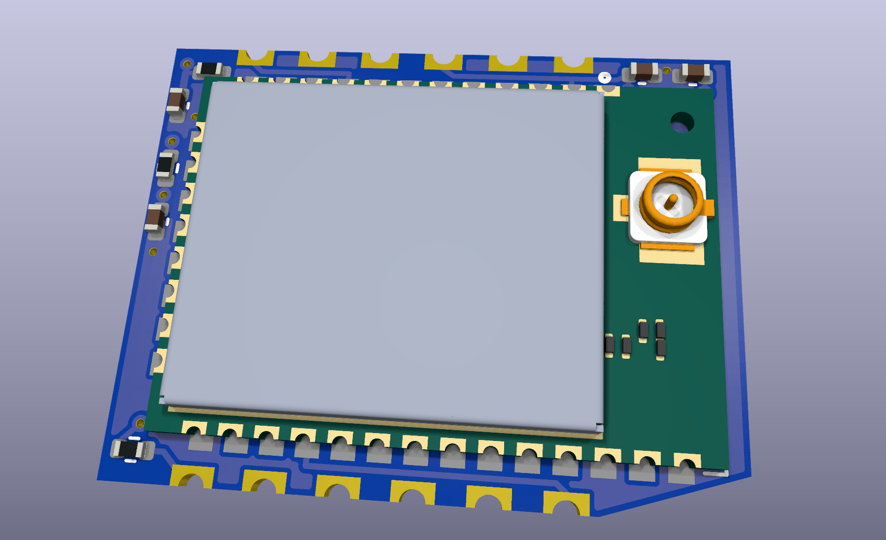
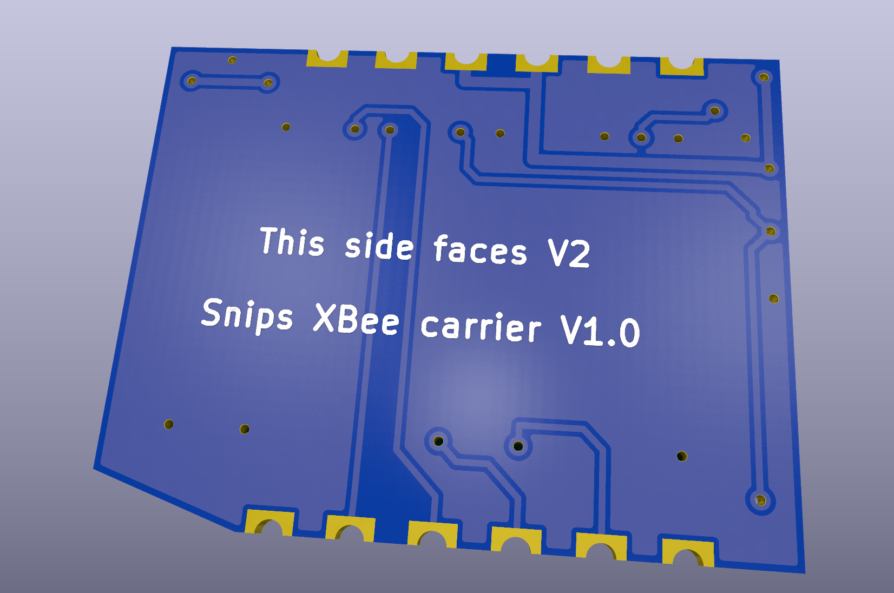

# Snips XBee carrier

A 2-layer castellated daughter board that puts a Digi XBee 3 PRO Micro on the V2 controller's underside. It is optional, and V2 runs without it. The mating footprint on V2 is `U_XBEE1`, `XBee_Carrier_Castellated`.

<p align="center">
  
  
</p>

A STEP model of the assembled board is in [`step/xbee_carrier.step`](step/xbee_carrier.step).

## Board

- **Size:** 22 x 17 mm, 0.8 mm thick, 2 layers. The chamfer clears the MH3 shell post on V2.
- **Orientation:** the XBee side faces away from V2 and the bottom sits flat on V2's underside. This board's top view matches V2's footprint coordinates directly, and the chamfer shows which way round it goes.
- **Height below V2:** about 3.2 mm with the module, plus the U.FL plug.
- **Edge:** 12 plated half holes at 2.54 mm pitch. Order as castellated holes, with a finish that wets well, such as ENIG.
- **Clearance:** the board uses 0.15 mm in the corridors between the module's pad tips and the castellations (`xbee_carrier.kicad_dru`).

## Assembly

- Reflow on the top side only. The module is MSL 3, so follow Digi's handling rules.
- Check that nothing is left proud on the bottom. It has no parts, and V2's vias under it are tented.
- Solder the carrier to V2 by hand, through the 1.7 mm of V2 land that extends past each castellation.

## Electrical

| Part | Value | Purpose |
|---|---|---|
| C_XB_47P1, C_XB_1U1 | 47 pF, 1 µF | At pad 2, per Digi 90001543 p.52. 25 V part for the 1 µF, so it keeps its value at 3.3 V |
| C_XB_10U1 | 10 µF 0402 | Digi's recommended bulk cap. About 4 µF at 3.3 V, and V2's rail is close by |
| R_XB_RST_PU1, C_XB_RST1, R_XB_RST1 | 10 kΩ, 100 nF, 100 Ω | V2 drives RESET open drain, so the pull-up is here. About 1 ms of reset as the rail rises |
| R_XB_ATTN_PU1 | 10 kΩ | BOOTMODE shares this pin and must not be low at reset |

Pads 1-6 are CTS, DIN, DOUT, RTS, ON/SLEEP and RESET. Pad 7 is SLEEP_RQ, 8 GND, 9-10 3V3, and 11-12 GND. Names match V2's nets.

## Layout rules

- No top-side copper under the module, and no copper or vias at its three RF test points (Digi 90001543 p.58). The `XB3-24Z8UM` footprint carries both as rule areas. Signals cross under the module on the bottom layer. The top-side rule stops 0.5 mm short of the module's edge, so pads can reach their vias.
- Test point positions come from the bottom view on p.34, since the manual has no Micro keepout drawing.
- The 3D model is Digi's `XB3-UFL-MMT.STEP`.

## Checks

```
stackup check PCB/v2.x/xbee-carrier/stackup/board.kdl
```

CI checks the design, the BOM and the PCB sync. Sync with the Stackup KiCad plugin after any KDL change.

## Production

Files are in `production/`, built from this board: `jlcpcb/` holds the order set as `Snips_XBee_Carrier_1_0.zip` with its BOM and positions, and `gerbers/`, `placement/` and `bom/` hold the separate exports. Regenerate them after any board change.

When ordering:

- Select castellated holes. The job file marks the board as castellated, and there are 12 half holes on the two long edges.
- Use 0.8 mm thickness and ENIG. The board file's copper finish is unset, so choose this in the order.
- The XBee has no JLC stock, so plan to consign XB3-24Z8UM modules. Mouser and DigiKey stock it.
- Blue solder mask, to match V2.

## Bench checklist

1. Before soldering to V2, meter for shorts between 3V3 and GND, and between neighbouring castellations.
2. After soldering, check each of the 12 joints for continuity to its V2 net.
3. Confirm UART traffic, CTS, SLEEP_RQ and ON/SLEEP, then reset, then join a droid's network.
4. Repeat V2's power-off test with the carrier fitted, since it adds capacitance to the rail.
