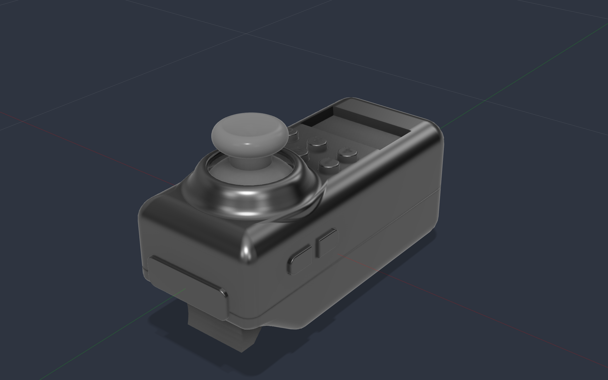
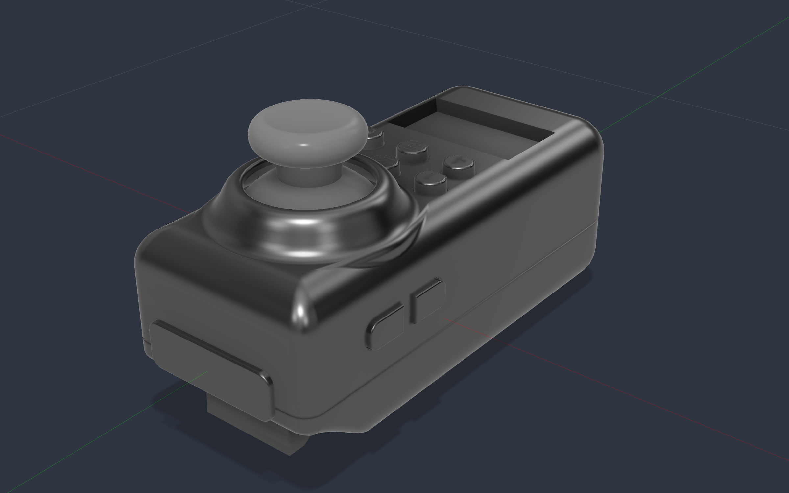
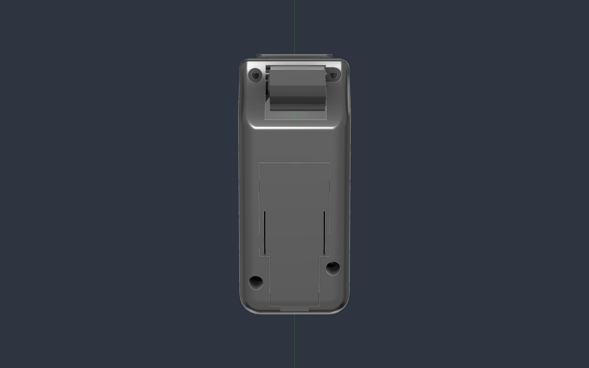
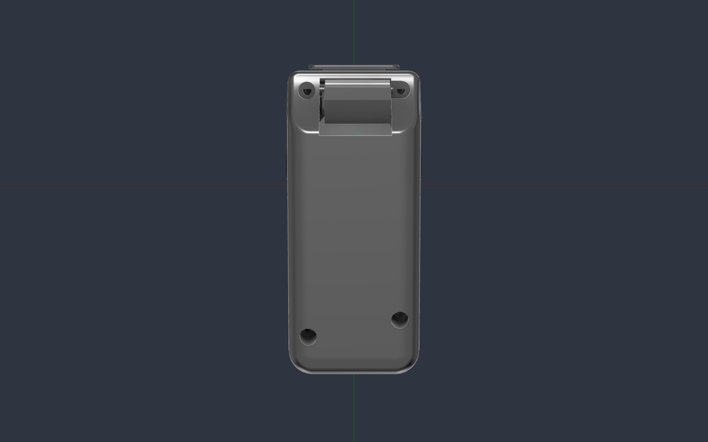
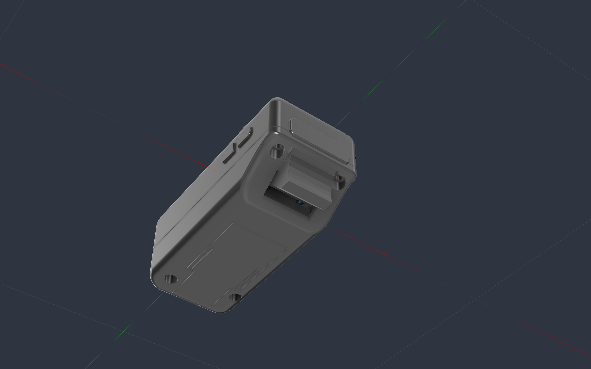
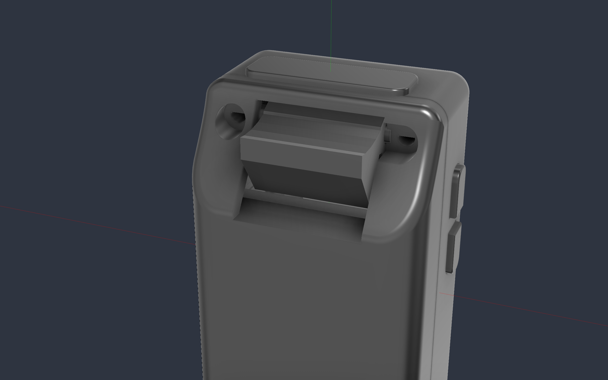
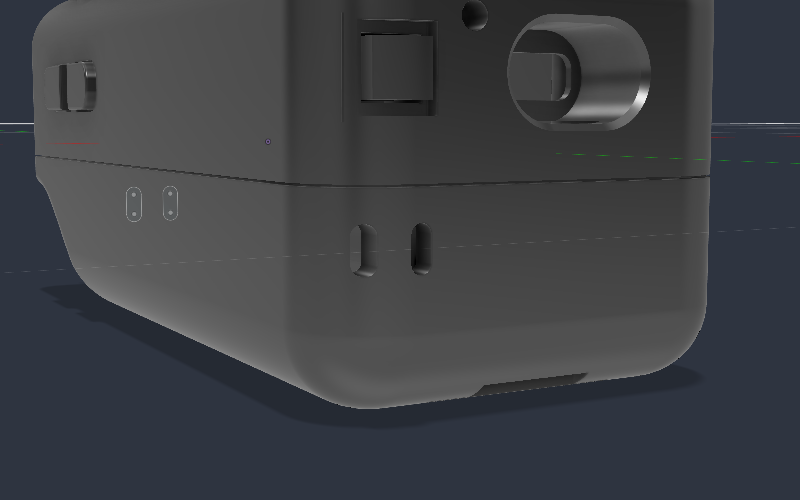
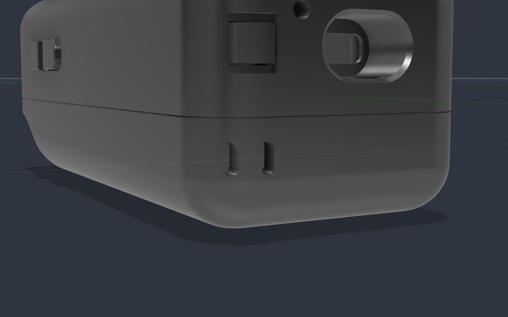

# Snips shell

One folder per board/shell revision. Keep old versions; start the next one by copying the folder.

```
shell/<version>/
  fusion/SnipsShell.f3d            the Fusion master (plus lib.py, sc_*.json used by the rebuild scripts)
  export/stl, export/step          raw per-part exports from Fusion (as modelled)
  export/print/stl, print/step     print-ready files (oriented, on Z=0), README.md, tools/
  export/reference/                non-printing reference parts
  export/_export_log.txt
  photos/
PCB/step/<version>/snips_controller.step   the board model for that revision (v1.1, v1.2)
```

## Exporting from Fusion
Write to `shell/<version>/export/` (use the version the Fusion doc belongs to), per component:
`createSTEPExportOptions(.../export/step/<Part>.step, comp)`, `createSTLExportOptions(comp, .../export/stl/<Part>.stl)`
(high refinement, binary), and `createFusionArchiveExportOptions(.../fusion/SnipsShell.f3d)`.
Then regenerate the print files (below).

## Print files
The tools in `export/print/tools/` find their folders from their own location, so run them from that version's
`tools/` folder and they read `export/stl|step` and write `export/print/stl|step`. Override with
`SNIPS_EXPORT_DIR` / `SNIPS_PRINT_DIR` if the files live somewhere else. See `export/print/README.md`.

## v2 variants: standard (14500) and pouch cell
v2 has two bottom shells that share everything else (TopShell, buttons, Bumper, TriggerPost, TriggerCaps, PCB).
Width and length are identical; only the height differs.

| | Standard (14500 cell) | Pouch cell (YDL103035) |
|---|---|---|
| Bottom shell | `BottomShell` | `BottomShell_Pouch` |
| Trigger | `Trigger` | `Trigger_Pouch` (shorter, scooped for the thinner shell) |
| Cell | 14500 (AA size) in the battery bay, `BatteryPanel` + contacts | 10 x 30 x 37 mm LiPo pouch, held by printed stops, JST PHR-2 lead |
| Extra parts | `BatteryPanel`, contact clip, contacts block | none |
| **Width** | 35.0 mm | 35.0 mm |
| **Length** | 80.65 mm | 80.65 mm |
| **Height, flat top surface to flat bottom** | **33.70 mm** | **30.32 mm** |
| Height incl. thumbstick bump | 39.0 mm | 35.62 mm |

Height is measured from the flat shell surface (not the thumbstick bump) to the bottom flat surface, so the pouch
variant is **3.38 mm** thinner. Both triggers rest 8 deg forward of vertical (parameters `trig_rest_deg` and
`pt_rest_deg`) with a 28 deg pull from there, which gives the finger a little more room at the front wall.
Both triggers are filleted where the finger touches them: 1.2 mm on the long edges across the blade (`trig_edge_r`) and 1.0 mm on the side-face outline along the blade (`trig_side_r`).
Reference cell model: `export/reference/stl|step/Cell_YDL103035_Ref.*`.

### Wrist strap anchor
Both bottom shells have two vertical slots through the rear-left corner (looking from the USB end, the left side), with a 2.2 mm
bar of wall between them. Push the strap's thin attachment loop in through one slot and back out of the other so it wraps the
bar. The centre of the rear wall is taken by the contact clip and 14500 bay on the standard shell, so the pair sits in the free
corner pocket (same position on both variants; the cut runs through the corner into the interior, which is clear behind it).
Defaults suit a 3 x 1 mm flat loop: slots 1.5 x 3.4 mm, centred x -12.4 mm, z -6 mm, parameters `strap_loop_w`, `strap_loop_t`,
`strap_clr`, `strap_bar_w`, `strap_x`, `strap_z`, `strap_cut_y`. The bar is the full wall thick and the corner makes it deeper
than the flat wall. Hang test it before relying on it with heavy loads; widen `strap_bar_w` if you want more margin (the pair
has about 1 mm to spare toward the bay wall on the standard shell).

### 14500 bay: ceiling and markings (standard shell)
The cradle arcs stop 45 deg above the cell equator, so on their own they leave the top of the cell open to the PCB. The XBee
module's underside (z -0.82 mm) is only 0.33 mm above the cell top (z -1.15 mm), so a cell with a worn wrap could float up
against it. The standard shell therefore has a 0.7 mm printed ceiling over the cell wherever the PCB parts leave room: the whole
rear (positive terminal) end from the clip to y -30.9 mm and the front (negative terminal) end from y -18.1 mm to the end of the
cradle at y -0.8 mm. There is no ceiling under the XBee module (keep-out y -30.9..-18.1 mm). Radial clearance to the cell is
unchanged (`bay_trench_clr` 0.25 mm). Parameters: `bay_ceil_top_z` (-0.2 mm, the lowest part above it is the 0.29 mm
inductor), `bay_ceil_z0`, `bay_ceil_w`, `bay_ceil_xb_y0`, `bay_ceil_xb_y1`.
Remaining float with the cell in: 0.25 mm to the ceiling at the two ends, 0.33 mm of clearance under the XBee module. A strip of
Kapton tape on the module underside adds margin for free.

The two flat ledges beside the cell (visible with the panel off) carry engraved polarity marks: **+** at the rear (palm) end,
**-** at the front (trigger) end, on both ledges, plus "Li-ion 14500 only" along the right ledge. Text height `pol_h`
(2.2 mm) / `pol_note_h` (1.8 mm), depth `pol_depth` (0.5 mm of the 1.6 mm ledge), position `pol_x`, `pol_y_lo`, `pol_y_hi`,
`pol_edge`. The text is engraved into a bridged ceiling when printed belly down, so expect it to print a little rough; it is a
shallow groove, not a stencil.

### Photos
`photos/snips_shell_*.png` show the standard variant, `photos/snips_shell_pouch_*.png` the pouch variant (same angles;
the pouch set has no top/thumbstick close-ups because the top is shared).

| Standard | Pouch |
|---|---|
|  |  |
|  |  |
|  |  |
|  |  |
